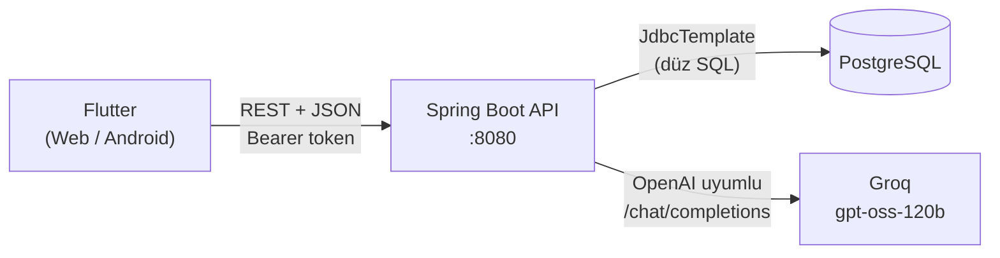
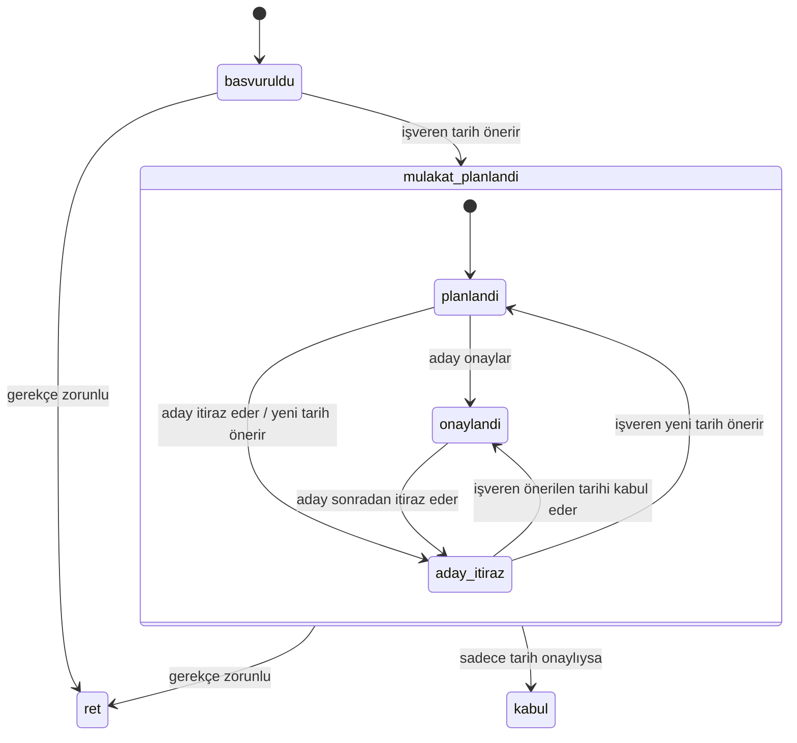

# **İŞ PUSULAM**


**Öğrenci ve yeni mezunlar için, becerilerin sınavla doğrulandığı, ilanların net tanımlandığı ve hiçbir adayın gerekçesiz reddedilmediği şeffaf bir kariyer platformu.**

> *"Yeteneğin, CV'nin ötesinde görünsün."*

`Spring Boot 3.4` · `Java 17` · `Flutter` · `PostgreSQL` · `Groq (gpt-oss-120b)`

---

## İçindekiler

1. Çözdüğümüz problem 
2. Demo
3. Özellikler
4. Mimari ve teknoloji seçimleri
5. Kurulum
6. Yapay zekâ kullanımı
7. Takım
8. Lisans


## Çözdüğümüz problem

İlk işini ya da stajını arayan biri genelde aynı üç duvara çarpıyor:

| Problem | Adayın yaşadığı | işPusulam'daki karşılığı |
|---|---|---|
| **Kanıtlanamayan beceriler** | CV'de "Java biliyorum" yazmak herkes için aynı görünüyor. Deneyimi olmayanın kendini gösterecek yeri yok. | Beceri sınavı ve Yetenek Görevi. Barajı geçen beceri profilde doğrulanmı rozetiyle görünür. |
| **Belirsiz ilanlar** | "Backend Developer" başlıklı, iki satırlık ilanlar. Ne istendiği belli değil. | İlan yayınlamak için en az 80 karakterlik iş tanımı, en az bir beceri, çalışma türü, çalışma şekli, deneyim ve eğitim seçimi zorunlu. |
| **Sessiz retler** | Başvuru yapılıyor, cevap gelmiyor ya da sadece "olumsuz" geliyor. Aday neyi geliştirmesi gerektiğini bilmiyor. | İşveren gerekçe yazmadan reddedemez. Gerekçe ve hangi aşamada elendiği adaya bildirim olarak gider. |

Bu kuralların hiçbiri sadece arayüzde değil; hepsi sunucu tarafında uygulanıyor. Yani API'ye doğrudan istek atan biri de gerekçesiz ret yapamaz ya da eksik ilan yayınlayamaz.


## Demo


**Demo videosu:** _[video linki]_

**Demo akışı:**
1. İşveren yalnızca "Backend stajyeri" yazar → yapay zekâ iş tanımını, becerileri, dil/eğitim/deneyim gereksinimlerini doldurur → ilan yayınlanır.
2. Aday İşler sayfasında ilanı eşleşme yüzdesiyle görür ve başvurur.
3. Aday Becerilerim'de Java için 10 soruluk yapay zekâ sınavına girer, barajı geçer → beceri doğrulanır, eşleşme yüzdesi artar.
4. İşveren mülakat tarihi önerir, aday itiraz edip yeni tarih önerir, işveren kabul eder.
5. İşveren başka bir adayı reddetmeye çalışır → gerekçe kutusu boş geçilemez → adaya gerekçeli bildirim düşer.


## Özellikler

### Aday tarafı

- **Eşleşme yüzdesine göre sıralı ilanlar.** Her ilanda adayın profiliyle yüzde kaç örtüştüğü görünür, en uygun ilan en üstte. Arama; başlıkta, şirket adında, açıklamada, konumda, istenen becerilerde ve gereksinimlerde birlikte yapılır.
- **Yapay zekâ ile beceri sınavı.**
  - 5, 10 veya 15 soru ve başlangıç / orta / ileri seviye seçilir.
  - Sorular her denemede yeniden üretilir, ezberlenemez.
  - Doğru cevaplar sadece sunucuda tutulur, uygulamaya hiç gönderilmez.
  - Sınavdan önce geçme notu ve kaç doğru gerektiği gösterilir (örnek: %70 baraj).
  - Sınav sonunda yanlış ve boş bırakılan her soru için doğru cevap ve açıklama gösterilir; eksik kaç doğru olduğu yazılır.
- **Yetenek Görevleri.** Çoktan seçmeli değil, açık uçlu kısa bir problem. Aday çözümünü yazar, yapay zekâ önceden tanımlanmış değerlendirme ölçütüne göre 0–100 puan ve kısa geri bildirim verir. Deneyimi olmayan aday da yeteneğini gösterebilir.
- **Listede olmayan beceri ekleme.** Aday "reactjs" yazarsa yapay zekâ bunun gerçek bir beceri olduğunu kontrol eder, "React" olarak düzeltir ve kataloğa ekler. Anlamsız ya da alakasız girişleri reddeder.
- **Profil tamamlanma yüzdesi.** Unvan, biyografi, CV bağlantısı, en az 3 beceri ve en az 1 doğrulanmış beceri; her biri %20.
- **3 seviyeli profil gizliliği.** Herkese açık / sadece doğrulanmış işverenler / gizli. Gizli profiller önerilen adaylarda hiç görünmez.
- **Mülakat tarihine itiraz.** Aday önerilen tarihi onaylayabilir ya da sebep yazarak itiraz edip yeni tarih önerebilir (onayladıktan sonra bile).
- **Şeffaf başvuru takibi.** Her başvurunun durumu, mülakat tarihinin onay durumu ve varsa ret gerekçesi tek ekranda.

### İşveren tarafı

- **Yapay zekâ destekli ilan formu.** Sadece pozisyon adını yazmak yeterli; yapay zekâ 4–6 cümlelik iş tanımı, sorumluluk maddeleri, 4–8 beceri (seviye + zorunlu/tercih), eğitim, bölüm, yabancı dil ve seviyesi, sertifika, deneyim, çalışma şekli ve türü önerir. İşveren her şeyi düzenleyebilir.
- **Uygun aday önerileri.** Henüz başvurmamış ama ilanla örtüşen ilk 10 aday, gizlilik ayarlarına uyularak listelenir.
- **Gerekçeli ret.** Ret kutusu boş ya da 10 karakterden kısa gerekçeyle kapanmaz. Tek dokunuşla doldurulabilen hazır gerekçeler var.
- **İki taraflı onaylı mülakat.** Mülakat tarihi iki taraf onaylamadan aday kabul edilemez.
- **Yapay zekâ ile mülakat soruları.** İlanın becerilerine ve gereksinimlerine göre 15 dakikalık bir görüşmeye uygun 5 soru üretilir. Üretilen sorular kaydedilir; tekrar açınca yapay zekâya yeniden gidilmez, istenirse yenileri üretilir.

### Ortak

- **Mesajlaşma.** Aday başvurduğu şirkete, işveren kendisine başvuran adaya yazabilir. Aday adaya, işveren işverene yazamaz. Okunmamış mesaj rozeti.
- **Bildirimler.** Yeni başvuru, mülakat daveti, tarih onayı/itirazı, kabul, ret ve beceri doğrulama için bildirim; menüde okunmamış sayısı.
- **Şirketler sayfası.** Doğrulanmış işveren rozeti ve şirket başına açık ilan sayısı.
- **Tek kod tabanı, birden fazla platform.** Arayüz geniş ekranda sol menü, dar ekranda alt pencere ve çekmece menüyle çalışır (Flutter Web ve Android).

---

## Mimari ve teknoloji seçimleri



Yapay zekâ anahtarı yalnızca sunucuda durur; Flutter uygulaması yapay zekâ servisine doğrudan hiç bağlanmaz.

### Başvuru yaşam döngüsü



### Teknoloji seçimleri ve nedenleri

| Katman | Seçim | Neden |
|---|---|---|
| Backend | **Spring Boot 3.4, Java 17** | Takım olarak en iyi bildiğimiz dil; REST uç noktaları ve bağımlılık enjeksiyonu hazır geliyor. |
| Veri erişimi | **JdbcTemplate (düz SQL)**, JPA yok | Şemayı ER diyagramından kendimiz tasarladık. Eşleşme, arama ve gizlilik kuralları gibi sorguları doğrudan SQL ile yazmak hem okunur hem kontrol bizde. |
| Veritabanı | **PostgreSQL** | `ILIKE` ile büyük/küçük harf duyarsız arama, `ON CONFLICT` ile güvenli ekleme, `RETURNING` ile tek sorguda ID alma. |
| Kimlik doğrulama | **BCrypt + HMAC-SHA256 imzalı token** | Sadece `spring-security-crypto` kullanıldı, tüm Spring Security eklenmedi. Token `kullaniciId.bitis.imza` biçiminde, 30 gün geçerli; veritabanında saklanmadığı için ek tablo gerekmiyor. İmza sabit zamanlı karşılaştırılıyor. Her uç nokta rolü (aday / işveren) sunucuda kontrol ediyor. |
| Veritabanı güncellemesi | **Açılışta otomatik, tekrar çalıştırılabilir SQL** | `guncelleme.sql` uygulama her açıldığında çalışır, sadece eksik tablo ve sütunları ekler (`IF NOT EXISTS`). Takımdaki herkes kodu çektiğinde veritabanı kendiliğinden güncel olur. |
| Arayüz | **Flutter + Provider** | Tek kodla web ve mobil. Oturum ve bildirim sayacı Provider ile tüm ekranlara dağıtılıyor. |
| Yapay zekâ | **Groq üzerinde `openai/gpt-oss-120b`** | Ayrıntısı [Yapay zekâ kullanımı](#yapay-zekâ-kullanımı) bölümünde. |

### Veritabanı

İlk şemayı ER diyagramıyla tasarladık: [`Database/işPusulam.drawio.pdf`](Database/işPusulam.drawio.pdf)

Temel tablolar: `kullanicilar` (ortak) → `adaylar` / `isverenler` (kalıtım), `beceriler`, `aday_becerileri`, `beceri_testleri`, `test_sorulari`, `cv`, `cv_test_loglari`, `is_ilanlari`, `ilan_kriterleri`, `basvurular`, `mulakatcilar`, `mulakatlar`, `ai_soru_talepleri`, `mulakat_sorulari`.

Sonradan eklenenler: `bildirimler`, `mesajlar`, `ilan_gereksinimleri`, `sinav_oturumlari`.

### Proje yapısı

```
isPusulam/
├── Database/
│   ├── da.sql                               # Ana şema (16 tablo)
│   ├── bildirimlerTable(sonradanEklendi).sql
│   ├── beceri_secenekleri.sql               # Hazır soru bankası ve Yetenek Görevleri
│   └── işPusulam.drawio.pdf                 # ER diyagramı
└── isPusulam_/
    ├── Backend/                             # Spring Boot, 46 REST uç noktası
    │   └── src/main/
    │       ├── java/com/ispusulam/
    │       │   ├── AuthController.java       # Kayıt / giriş
    │       │   ├── IlanController.java       # İlanlar, başvuru, aday önerisi
    │       │   ├── BasvuruController.java    # Mülakat, itiraz, kabul, gerekçeli ret, AI soruları
    │       │   ├── BeceriController.java     # Beceriler, AI sınavı, Yetenek Görevleri
    │       │   ├── AiController.java         # AI ile ilan doldurma, AI durum testi
    │       │   ├── MesajController.java      # Aday ↔ işveren mesajlaşma
    │       │   ├── ProfilController.java     # Profil, gizlilik
    │       │   ├── SirketController.java
    │       │   ├── BildirimController.java
    │       │   ├── YapayZekaServisi.java     # Sağlayıcıdan bağımsız AI istemcisi
    │       │   ├── BeceriServisi.java        # AI ile beceri doğrulama ve ekleme
    │       │   ├── Eslestirici.java          # Eşleşme yüzdesi
    │       │   ├── Oturum.java               # Token üretme / doğrulama
    │       │   └── BaslangicAyari.java       # Açılışta DB güncellemesi
    │       └── resources/
    │           ├── application.properties.ornek
    │           └── guncelleme.sql
    └── Frontend/                            # Flutter
        └── lib/
            ├── core/      # api, oturum, tema, ayarlar, bildirim sayacı
            ├── screens/   # giriş, ana sayfa, işler, beceriler, başvurular, ilanlar, mesajlar...
            └── widgets/   # ret kutusu, gereksinim listesi, ortak bileşenler
```

---

## Kurulum

### Gereksinimler

- Java 17 ve Maven
- PostgreSQL (ve isteğe bağlı pgAdmin)
- Flutter SDK (Dart 3.3 veya üstü)
- Ücretsiz bir Groq API anahtarı: [console.groq.com](https://console.groq.com) → API Keys (`gsk_` ile başlar)

### 1. Veritabanı

PostgreSQL'de `isPusulam` adında boş bir veritabanı oluşturun ve sırasıyla çalıştırın:

```bash
psql -U postgres -d isPusulam -f Database/da.sql
psql -U postgres -d isPusulam -f "Database/bildirimlerTable(sonradanEklendi).sql"
```

Mesajlar, ilan gereksinimleri, mülakat itirazı ve AI sınavları için gereken tablolar backend ilk açıldığında `guncelleme.sql` ile **otomatik** eklenir.

İsteğe bağlı: `Database/beceri_secenekleri.sql`, kataloğunuzda bulunan beceriler (Java, Spring Boot, SQL, Flutter, Python, React, Figma, İngilizce vb.) için hazır soru bankası ve iki Yetenek Görevi ekler. Becerileri ID'ye göre değil adına göre eşleştirir, iki kez çalıştırılması sorun çıkarmaz. Yapay zekâya ulaşılamadığında sınavlar bu bankadan yapılır.

### 2. Backend

```bash
cd isPusulam_/Backend/src/main/resources
cp application.properties.ornek application.properties
```

`application.properties` içinde şu üç alanı doldurun:

```properties
spring.datasource.password=VERITABANI_SIFRENIZ
ai.api-key=gsk_...                       # veya AI_API_KEY ortam değişkeni
uygulama.gizli-anahtar=en-az-20-karakterlik-rastgele-bir-yazi
```

> `application.properties` `.gitignore` içindedir; API anahtarı repoya girmez.

Çalıştırın:

```bash
cd isPusulam_/Backend
mvn spring-boot:run
```

Sunucu `http://localhost:8080` adresinde açılır. Yapay zekâ bağlantısını test etmek için tarayıcıda açın:

```
http://localhost:8080/api/ai/durum
```

`"calisiyor": true` görüyorsanız hazırsınız.

### 3. Frontend

```bash
cd isPusulam_/Frontend
flutter pub get
flutter run -d chrome
```

Backend adresi `lib/core/ayarlar.dart` içinde platforma göre otomatik seçilir:

| Nerede çalışıyor | Adres |
|---|---|
| Chrome (web) | `http://localhost:8080` |
| Android emülatör | `http://10.0.2.2:8080` |
| Gerçek telefon | Bilgisayarın yerel IP'si, ör. `http://192.168.1.25:8080` (dosyada elle yazılır) |

> Not: Sınav ve görev özelliklerini kullanmak için aday profilinde bir CV bağlantısı olmalı; sınav sonuçları CV kaydına bağlı tutulur.

---

## Yapay zekâ kullanımı

### Model

**`openai/gpt-oss-120b`**, **Groq** üzerinden, OpenAI uyumlu `/chat/completions` arayüzüyle.

### Nerede kullanıyoruz?

| Özellik | Yapay zekânın görevi | Çıktıyı nasıl denetliyoruz |
|---|---|---|
| İlan formunu doldurma | Pozisyon adından iş tanımı, maddeler, beceriler ve tüm gereksinimleri önermek | Eğitim, deneyim, çalışma şekli/türü ve dil seviyesi **sadece bizim sabit listelerimizden** kabul edilir; liste dışı değer atılır. Aynı beceri iki kez eklenmez. İşveren yayınlamadan önce her şeyi düzenleyebilir. |
| Beceri sınavı | Seçilen beceri ve seviye için 4 şıklı sorular ve açıklamaları üretmek | Fazladan 2 soru istenir; 4 şıkkı olmayan, tek harfli doğru cevabı olmayan, boş şıklı veya tekrar eden sorular atılır. "A) " gibi önekler temizlenip yeniden eklenir. 5'ten az geçerli soru kalırsa sınav başlatılmaz. |
| Yetenek Görevi | Açık uçlu cevabı ölçüte göre 0–100 puanlamak | Ölçüt (iyi bir cevabın neleri içermesi gerektiği) veritabanında bizim tarafımızdan yazılı. Puan 0–100 aralığına sıkıştırılır. |
| Mülakat soruları | İlana özel 5 soru üretmek | Sorular kaydedilir ve tekrar kullanılır; her açılışta yeniden üretilmez. |
| Beceri kataloğu | Kullanıcının yazdığı becerinin gerçek olup olmadığını kontrol edip doğru yazımını bulmak | Geçersizse kullanıcıya sebebiyle birlikte reddedilir. |

### Neden bu model ve bu sağlayıcı?

- **Başta DeepSeek ile başladık.** Varsayılan "düşünme modu" yüzünden cevaplar 60 saniyeyi aşıyordu; modu kapattık, zaman aşımlarını düzenledik. Ardından ücretli bakiye gerektirmeyen bir seçenek arayıp **Groq'a geçtik** (commit geçmişinde görülebilir).
- **Hız:** gpt-oss modellerinde `reasoning_effort: low` kullanıyoruz; 10–15 soruluk sınav bile kullanıcıyı bekletmeden üretilebiliyor.
- **Sağlayıcıdan bağımsız:** `YapayZekaServisi` OpenAI uyumlu her servisle çalışıyor. Sağlayıcıyı değiştirmek için kod değil, sadece `ai.base-url` ve `ai.model` değişiyor. DeepSeek'e özel ayar yalnızca adres DeepSeek ise gönderiliyor.
- **Yapılandırılmış çıktı:** Her istekte `response_format: json_object` kullanıyoruz. Model cevabı yine de ```` ```json ```` bloğuna sararsa temizleyip çözüyoruz.

### Bilinçli olarak yapay zekâ kullanmadığımız yer: eşleşme yüzdesi

Adayı ilana eşleştiren puanı **yapay zekâya bırakmadık**, çünkü bir adayın neden üstte ya da altta göründüğü açıklanabilir olmalı. Formül basit ve açık:

```
İlanın istediği her beceri için:
    adayda doğrulanmış ise   → 1.0 puan
    sadece beyan edilmiş ise → 0.6 puan
    yoksa                    → 0
Eşleşme % = toplam puan / istenen beceri sayısı × 100
```

Bu yüzden beceri doğrulamak adayın eşleşmesini doğrudan yükseltir.

### Sınırlar

- **Yapay zekâ hata yapabilir.** Üretilen bir sınav sorusunun doğru cevabı nadiren tartışmalı olabilir. Her sorunun açıklamasını adaya gösteriyoruz, böylece hata fark edilebilir; ama insan kontrolünden geçmiyor.
- **Açık uçlu puanlama özneldir.** Yetenek Görevi puanı bir ölçüte bağlı olsa da aynı cevap farklı denemelerde birkaç puan farklı değerlendirilebilir.
- **Ücretsiz kota.** Groq'un ücretsiz katmanında dakikalık istek sınırı var. Sınır aşılırsa (429) kullanıcıya Türkçe ve anlaşılır bir mesaj gösteriliyor; tüm hata kodları (401, 402, 429, 5xx) bu şekilde çevriliyor.
- **Yedek plan.** Yapay zekâya ulaşılamazsa beceri sınavı veritabanındaki hazır soru bankasıyla devam eder ve kullanıcıya bu bildirilir. Beceri ekleme de yapay zekâ kapalıyken engellenmez, beceri "Diğer" kategorisiyle eklenir.
- **Gizlilik.** Yapay zekâya adayın adı, iletişim bilgisi veya CV'si gönderilmiyor; yalnızca beceri adı, seviye, pozisyon ve ilan gereksinimleri gönderiliyor. (Yetenek Görevi'nde adayın yazdığı cevap metni değerlendirme için gönderilir.)

## Takım

**PUSULA**

 **Ravza Koç** --> https://github.com/ravzakoc8
 **Selena Sürücü** --> https://github.com/selenasurucu
 **Betül Alkan** --> https://github.com/Betul006


